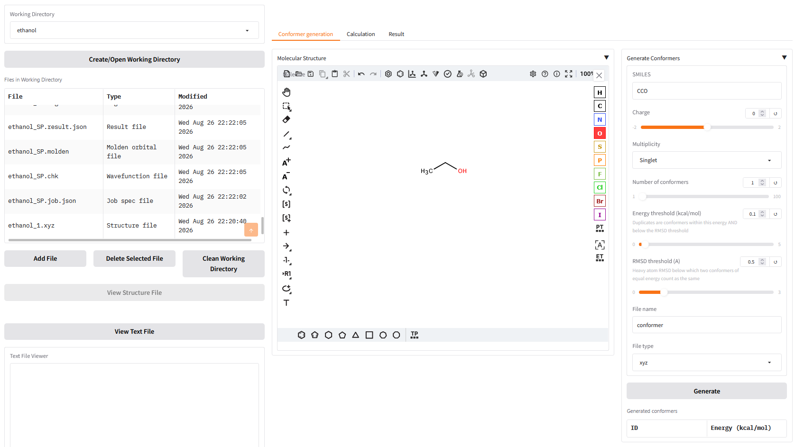
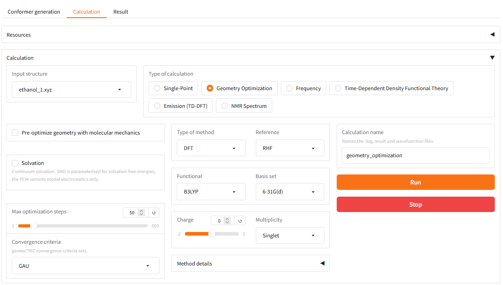
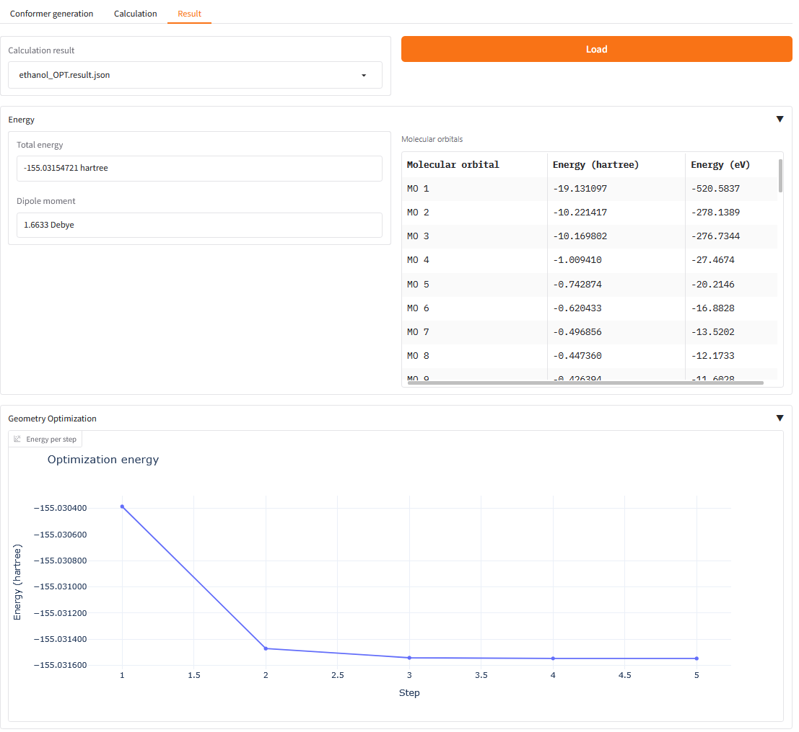
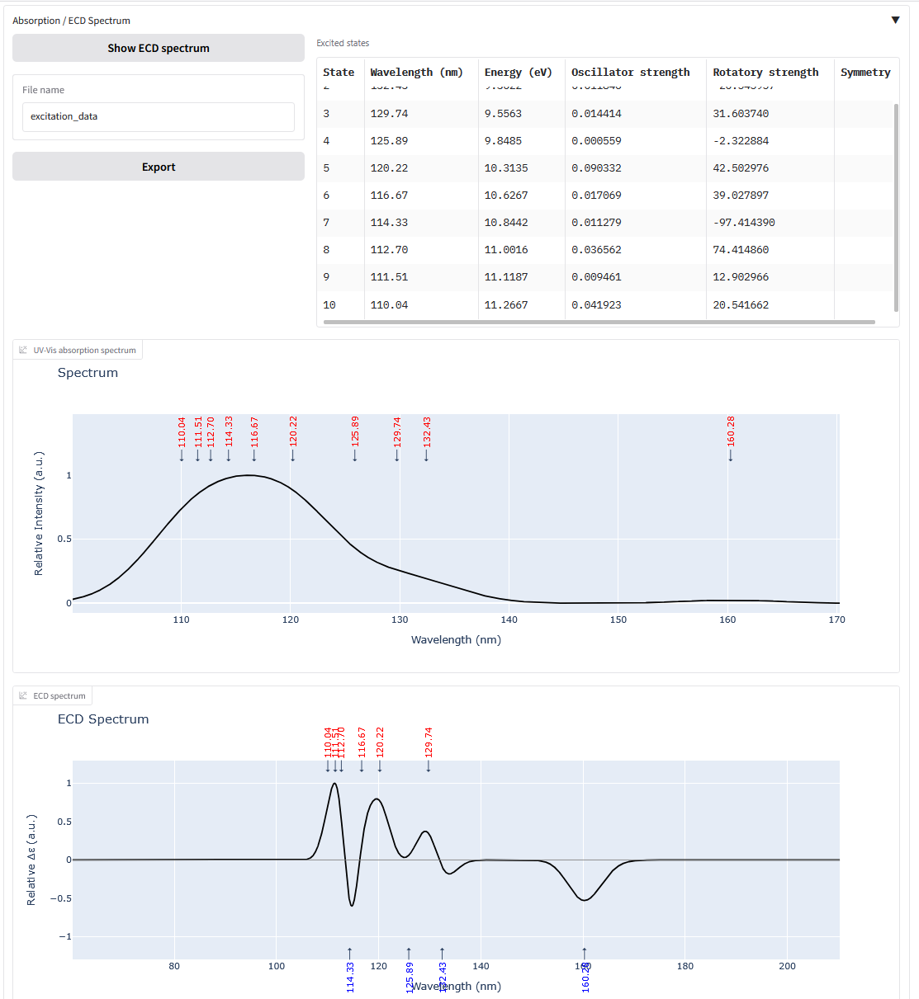
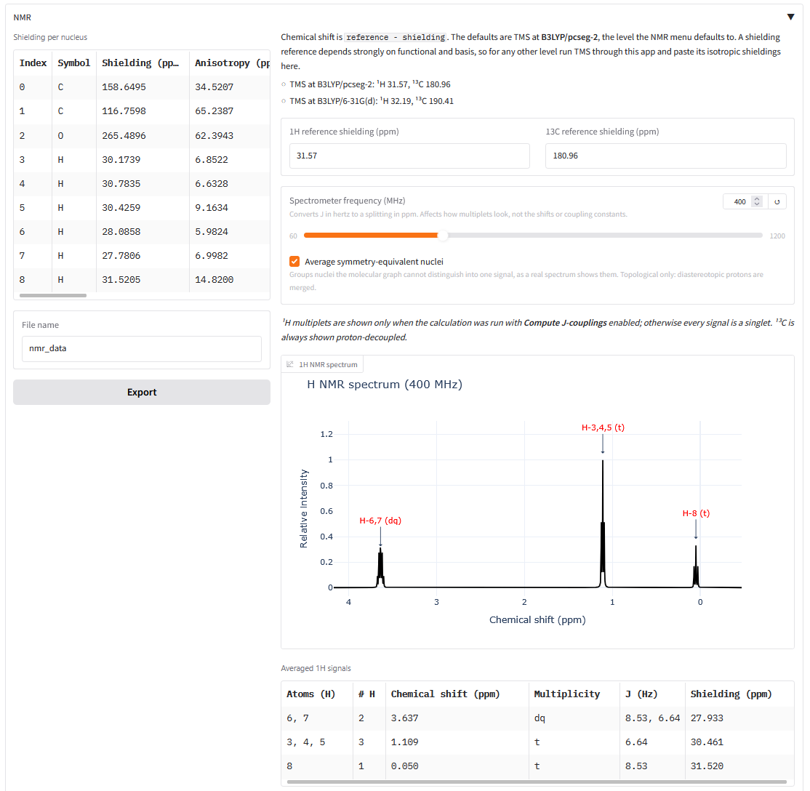
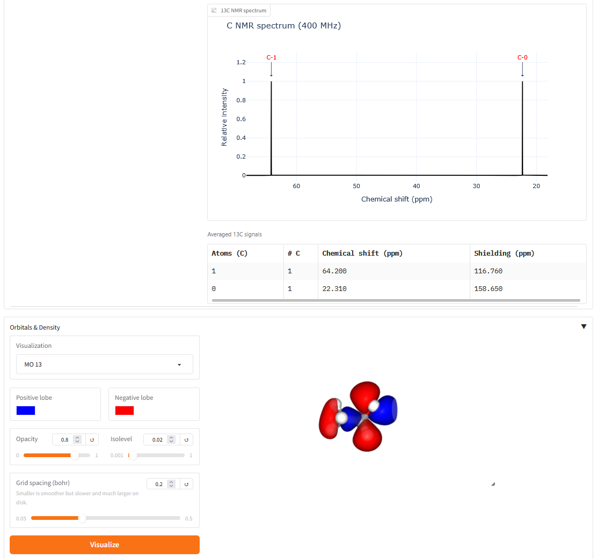

## Introduction

A Gradio web UI for computational chemistry with [PySCF](https://pyscf.org/) and
[gpu4pyscf](https://github.com/pyscf/gpu4pyscf), organized around a **working
directory**: generate conformers, run calculations on them, and inspect the results — all
in one folder you can come back to.








**Features**

- **GPU acceleration** — SCF, DFT, gradients and Hessians run on the GPU through
  gpu4pyscf when one is available, and fall back to CPU PySCF when it is not.
- **Working directories** — every structure, log, result and export lives in a named
  folder under `data/`, with a file browser, a 3D structure viewer and an editable text
  viewer.
- **Conformer generation** — draw a molecule or type SMILES, then embed *N* unique
  conformers with RDKit (MMFF94/UFF minimized, deduplicated by both energy and heavy-atom
  RMSD).
- **Calculations** — Single-Point, Geometry Optimization, Frequency (with IR spectrum and
  thermochemistry), TD-DFT (UV-Vis and ECD spectra), Emission, and NMR.
- **NMR spectra** — GIAO shielding on the GPU, with symmetry-equivalent nuclei averaged into
  single signals and simulated ¹H and ¹³C spectra. Chemical shifts are referenced against
  editable TMS values, applied at display time so changing one re-renders instantly.
- **J-couplings, on demand** — tick *Compute J-couplings* on an NMR job and the ¹H spectrum
  is split into real first-order multiplets (ethanol gives the textbook CH₃ triplet /
  CH₂ quartet), with a multiplicity and J column in the signal table.
- **Menus that follow the calculation type** — the functional and basis lists change with
  what you are calculating, because the constraints genuinely differ: NMR cannot use a
  range-separated functional, TD-DFT wants one, and NMR gets Jensen's `pcseg-*` sets. A
  selection that is still valid for the new type is kept; one that is not falls back to that
  type's default.
- **Orbitals and densities** — after a calculation, visualize the electron density, the
  electrostatic potential, the spin density, or any molecular orbital as an isosurface,
  without re-running anything.
- **Portable output files** — PySCF has no output format of its own, so every job writes
  its own: a readable log, a `.chk` wavefunction, a `.molden` orbital file, normal modes
  in Molden format, and bulk arrays in HDF5. See [Generated files](#generated-files).

## Installation

***For Linux and macOS***

```
python3 -m venv pyscf-env
source pyscf-env/bin/activate
```

***For Windows***

```
python -m venv pyscf-env
pyscf-env\Scripts\activate.bat
```

Then install the package:

```
pip install -e .
```

This pulls in PySCF, geomeTRIC and `pyscf-properties` (the last is needed for NMR
J-couplings). It does **not** pull in GPU support — see below.

The 2D sketcher in the Conformer tab is optional and must be installed separately,
because it pins an incompatible Gradio version:

```
pip install --no-deps gradio_molecule2d
```

### GPU support (optional)

```
pip install -e ".[gpu]"
```

This pulls in `gpu4pyscf-cuda12x`, `cupy-cuda12x` **and the `nvidia-*-cu12` runtime
wheels**. The runtime wheels are listed explicitly and are not optional: without them
`import gpu4pyscf` fails with

```
ImportError: Failure finding "libnvJitLink.so"
```

even though `import cupy` succeeds and reports a device, which makes the cause hard to
guess. A system CUDA toolkit does not substitute unless it is CUDA 12.

The app checks for a usable GPU at startup, in a subprocess, and simply disables the
"Use GPU" checkbox if there is not one — it runs on CPU either way.

## Start the web UI

```bash
pyscf-webui
```

## Usage

1. **Working Directory** (left column) — type a name and press *Create/Open*. Everything
   else happens inside it. You can also upload your own `.xyz`/`.pdb`/`.mol`/`.mol2`.
2. **Conformer generation** — draw or type a SMILES, set the charge, multiplicity and how
   many conformers you want, and press *Generate*. Each conformer is written as its own
   structure file.
3. **Calculation** — pick a structure, a calculation type and a method, then press *Run*.
   The PySCF output streams in below while it works.
4. **Result** — pick the result file and press *Load*. Only the sections the calculation
   actually produced are shown: energy and orbitals always, plus an optimization plot, an
   IR spectrum and thermochemistry, UV-Vis and ECD spectra, an emission band, or NMR
   shieldings and spectra. Tables export to CSV.

## Generated files

PySCF prints to a stream and writes no files of its own, so this app generates them. Each
job in a working directory produces:

| File | What it is |
| --- | --- |
| `<name>.log` | The engine's output — SCF cycles, the optimizer table, the frequency and excited-state tables. Streamed live into the Calculation tab. |
| `<name>.result.json` | Structured results. This is what the Result tab reads; it never parses the log. |
| `<name>.job.json` | The job spec handed to the child process. |
| `<name>.chk` | The converged wavefunction (PySCF HDF5 checkpoint). Lets the orbital viewer make cubes later without re-running the SCF. |
| `<name>.molden` | Orbitals in Molden format — opens in Avogadro, Jmol, Multiwfn, GaussView. |
| `<name>.freq.molden` | Normal modes, for animating vibrations in an external viewer (Frequency jobs). |
| `<name>.arrays.h5` | Hessian, normal modes, transition moments, full NMR shielding tensors — the bulk arrays, kept out of the JSON. |
| `<name>_optimized.xyz` | Final geometry, with a `<charge> <multiplicity>` header so it feeds straight back in as an input structure. |
| `<name>_trajectory.xyz` | Standard multi-frame XYZ, so external viewers can animate the optimization. |
| `cubes/<name>/*.cube` | Generated on demand by the Orbitals & Density viewer. |

## Known limitations

- **IR intensities need a closed-shell calculation on the GPU.** PySCF has no CPU
  implementation of dipole derivatives, and gpu4pyscf's implementation requires a restricted reference. Open-shell
  and CPU frequency jobs still report frequencies and thermochemistry; the intensity
  column and the IR spectrum are omitted rather than filled with zeros.
- **Open-shell Hessians fall back to the CPU.** gpu4pyscf 1.8.1 fails on an unrestricted
  density-fitted Hessian (an assertion in `hessian/uks.py`). The runner catches this and
  retries on the CPU automatically, which is slower but gives the same answer.
- **ROHF is not available** for Frequency, TD-DFT, Emission or NMR — neither PySCF nor
  gpu4pyscf ships an ROHF/ROKS Hessian, TD or shielding module. The UI blocks the
  combination.
- **MP2, CCSD and CCSD(T) run their correlated step on the CPU** regardless of the GPU
  setting. The SCF beneath them still runs wherever you asked.
- **NMR shielding requires the GPU and a closed-shell DFT method.** gpu4pyscf's code is the
  only working implementation in this stack, and it needs a restricted reference and rejects
  range-separated functionals outright. (`pyscf.prop.nmr` is installed, since J-couplings
  need the same package, but its shielding module is incompatible with PySCF 2.14 and
  cannot serve as a CPU fallback. J-couplings themselves are unaffected.) The menus
  are filtered accordingly, and any remaining unsupported combination is refused before the
  calculation starts rather than failing part way in.
- **J-couplings are CPU-only and optional.** gpu4pyscf has no spin–spin module, so they come
  from `pyscf.prop.ssc` (the `pyscf-properties` package) and do not benefit from the GPU.
  Absolute accuracy is limited by the basis: the Fermi-contact term needs tight s functions,
  and PySCF does not ship the `pcJ-n` sets designed for it, so ¹J(C–H) in methane comes out
  at 138 Hz against 125 Hz experimental. Couplings *between* protons — the ones that set the
  multiplicities — are much better behaved.
- **Multiplets are first order and conformer-specific.** There is no full spin-system
  diagonalization, and no conformational averaging beyond the group averaging described
  above, so strongly-coupled (second-order) systems will not look right.
- **Equivalent-nucleus averaging is topological.** It uses the molecular graph, so
  diastereotopic protons are merged even though a real spectrum resolves them.

## Development

```bash
pip install -e ".[dev]"
pytest
```

Tests that need PySCF or a GPU skip themselves when it is missing, so the suite runs in a
bare checkout.
